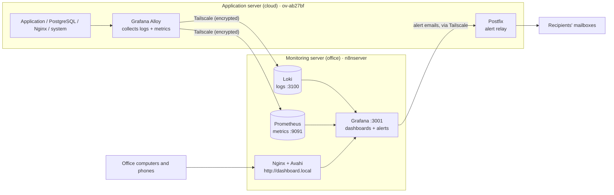

# grafana-setup — monitoring stack

Private repository: https://github.com/DevopsBBi/grafana-setup · local copy on the Mac: `~/Desktop/Grafana`

Monitoring of the application server (Odoo 18 + PostgreSQL 14 + Nginx on the VPS `ov-ab27bf`),
with the data stored and shown on the office server `n8nserver`.
Everything needed to **understand, check and rebuild** it is in this repository. No secret is stored here.



## What is where

| Path | Content |
|---|---|
| `inventory.env` | Machines, addresses, ports, names (no secret) |
| `secrets.env.example` | The secrets the install scripts need. Copy to `secrets.env` on a server (ignored by git) |
| `vps/` | Application server: Alloy configuration, Postfix relay, PostgreSQL role, `install.sh` |
| `monitoring/` | Monitoring server: Loki, Prometheus container, Grafana (settings, data sources, dashboards, alerts), dashboard.local, `install.sh` |
| `scripts/collect-*.sh` | Export the **live** configuration of a server (secrets removed) |
| `scripts/import.py` | Put an export into this repository |
| `scripts/check.sh` | Health check of a server (read-only) |
| `tools/dashboards/` | Python that generates the dashboard JSON |
| `state/` | Snapshots of the live servers (ports, firewall, versions...), written by `import.py` |
| `docs/` | Step-by-step history, rebuild guide, Alloy explained, alert runbook, operations, improvements |

## Documentation

1. [Every step we did, with its commands](docs/01-steps.md) (also as JSON: [docs/steps.json](docs/steps.json))
2. [Rebuild a server from this repository](docs/02-rebuild.md)
3. [The Alloy configuration, block by block](docs/03-alloy-explained.md)
4. [What to do when an alert email arrives](docs/04-alerts-runbook.md)
5. [Day-to-day operations](docs/05-operations.md)
6. [Known weaknesses and next improvements](docs/06-improvements.md)

## The two flows

```text
Live server  --collect-*.sh-->  _import/*.tgz  --import.py-->  repository  --git commit / push-->  remote
Repository   --git clone on the server-->  sudo bash vps/install.sh  |  sudo bash monitoring/install.sh
```

- **After a change made on a server or in Grafana:** collect, import, review `git diff`, commit, push.
- **To rebuild or repair a server:** clone the repository on it, create `secrets.env`, run its `install.sh`, then `scripts/check.sh`.

## Quick checks

```bash
bash scripts/check.sh vps          # on the application server
bash scripts/check.sh monitoring   # on n8nserver
```

## Rules

- Never commit `secrets.env`, passwords, tokens or keys. `scripts/collect-*.sh` removes them and `.gitignore` blocks the usual files.
- Keep the remote repository **private**: it describes the company's infrastructure (addresses, names, ports).
- Change a dashboard in Grafana or in `tools/dashboards/`, never in both at the same time without re-importing.
